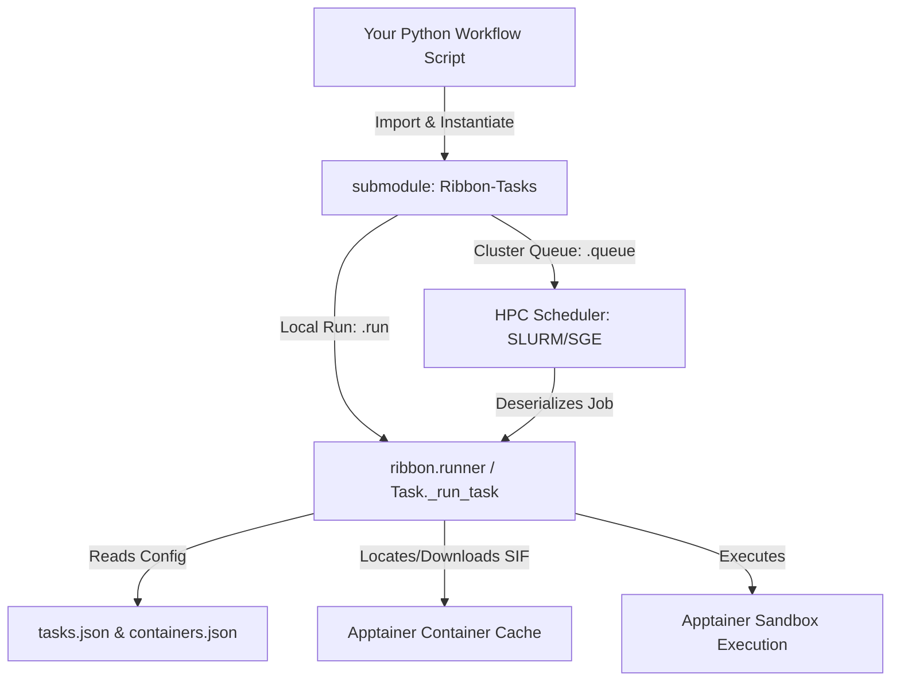

# Ribbon Workflow Scripting & Agent Guide

Welcome to the **Ribbon** workflow automation guide. This document serves as the primary onboarding and reference guide for **developers, new users, and AI coding agents** who want to script complex, containerized structural biology and protein design workflows in Python.

---

## 1. System Architecture

Ribbon is a modular framework designed to run complex computational biology tools under a unified Python API. By design, it eliminates dependencies installation and "DLL hell" on host machines by orchestrating execution within highly-optimized, pre-configured **Apptainer (Singularity) containers**.



### Submodule Architecture & Customizability
The tasks themselves are defined in **Ribbon-Tasks**, which is integrated as a **Git submodule** within the main Ribbon repository. Because it is a submodule, it is designed to be **fully user-editable and customizable**:
* **User-Editable Tasks**: Developers and end-users are encouraged to create, customize, or modify tasks directly by editing the Python task source code (e.g. `tasks.py`) and configuration files (`tasks.json`, `containers.json`) inside the submodule.
* **Direct Module-Level Imports**: Although tasks are defined and edited inside the `Ribbon-Tasks` submodule, Ribbon automatically imports and exposes all of them directly at the root module level. 

---

## 2. Programmatic Python API

The preferred way to use Ribbon tasks in your Python scripts is to import `ribbon` and instantiate the classes directly from it.

### Standard Task Lifecycle
Every Task follows a three-step API lifecycle:

```python
import ribbon
from pathlib import Path

# 1. Instantiate the task directly from the ribbon module
relax_task = ribbon.FastRelax(
    pdb_input_file="input.pdb",
    output_dir="relaxed_outputs/",
    nstructs=5,
    device="cpu", # 'cpu', 'gpu', or 'gpu_wsl'
    dry_run=False # Set to True to skip Apptainer run and produce mock files
)

# 2. Run the task
# Option A: Run immediately on the local machine
relax_task.run()

# Option B: Submit the task as a job to an HPC Cluster Scheduler (SLURM or SGE)
# job_id = relax_task.queue(
#     scheduler="SLURM", 
#     time="2:00:00", 
#     mem="8G", 
#     gpus=1, 
#     depends_on=[]
# )
```

---

## 3. High-Quality Scripting Templates

Below is a realistic, end-to-end Python pipeline script for chaining Ribbon tasks. It contains a complete `dry_run` option at the pipeline level that propagates down to every individual task, allowing you to instantly run the whole workflow in mock mode.

### De Novo Protein-Ligand Design & Validation Pipeline
This pipeline demonstrates how to prepare a small molecule ligand, design a protein backbone binder around it, perform sequence co-design, fold the resulting complexes to validate binding, relax them, and check atomic metrics.

```python
#!/usr/bin/env python3
"""
Ribbon Pipeline: De Novo Protein-Ligand Binder Design, Folding & Verification.
"""

import sys
import ribbon
from pathlib import Path

def run_design_pipeline(ligand_sdf: Path, scaffold_pdb: Path, output_root: Path, dry_run: bool = False):
    """
    Runs the complete protein-ligand design workflow.
    
    Args:
        ligand_sdf (Path): Input ligand SDF structure.
        scaffold_pdb (Path): Target protein scaffold PDB.
        output_root (Path): Output directory root.
        dry_run (bool): If True, executes in fast mock-run mode without running containers.
    """
    output_root.mkdir(parents=True, exist_ok=True)
    
    # -------------------------------------------------------------
    # Step 1: Prepare the Ligand for Rosetta
    # -------------------------------------------------------------
    print(">>> Stage 1: Preparing ligand topology...")
    lig_dir = output_root / "1_ligand_prep"
    ligand_prep = ribbon.RosettaLigandPrepare(
        input_file=ligand_sdf,
        output_dir=lig_dir,
        name="LG1",
        clobber=True,
        dry_run=dry_run
    )
    ligand_prep.run()
    
    prepared_pdb = lig_dir / "LG1_0001.pdb"
    prepared_params = lig_dir / "LG1.params"
    
    if not dry_run and not prepared_pdb.exists():
        raise FileNotFoundError(f"Ligand preparation failed to yield {prepared_pdb}")

    # -------------------------------------------------------------
    # Step 2: RFDiffusion All-Atom (Design Binder Scaffold)
    # -------------------------------------------------------------
    print(">>> Stage 2: Diffusing binder scaffold...")
    diff_dir = output_root / "2_rfdiffusion"
    rfdiff = ribbon.RFDiffusionAA(
        input_structure=scaffold_pdb,
        output_dir=diff_dir,
        contig_map="[A1-100/0 B1-10]", # Keep scaffold (A), leave 10 residue gap for binder (B)
        ligand=prepared_pdb,
        num_designs=2,
        device="gpu" if not dry_run else "cpu",
        dry_run=dry_run
    )
    rfdiff.run()
    
    # Find generated backbones
    generated_backbones = list(diff_dir.glob("*.pdb"))
    if dry_run and not generated_backbones:
        # Mock-run creates files inside dry_run logic, let's handle empty list safely
        generated_backbones = [diff_dir / f"design_{i}.pdb" for i in range(2)]
    elif not dry_run and not generated_backbones:
        raise FileNotFoundError("RFDiffusion failed to generate any backbones.")
    print(f"Generated backbones: {[b.name for b in generated_backbones]}")

    # -------------------------------------------------------------
    # Step 3: LigandMPNN (Sequence Co-design)
    # -------------------------------------------------------------
    print(">>> Stage 3: Designing sequences with LigandMPNN...")
    mpnn_dir = output_root / "3_ligand_mpnn"
    mpnn = ribbon.LigandMPNN(
        output_dir=mpnn_dir,
        structure_list=[str(b) for b in generated_backbones],
        num_designs=5,
        temperature=0.1,
        device="gpu" if not dry_run else "cpu",
        dry_run=dry_run
    )
    mpnn.run()
    
    # Seqs split output directory contains split FASTA files for each design
    designed_fasta_files = list((mpnn_dir / "seqs_split").glob("*.fasta"))
    if dry_run and not designed_fasta_files:
        designed_fasta_files = [mpnn_dir / "seqs_split" / f"design_{i}.fasta" for i in range(5)]
    print(f"Designed FASTA files: {[f.name for f in designed_fasta_files]}")

    # -------------------------------------------------------------
    # Step 4: Chai-1 (Structure Prediction & Binding Validation)
    # -------------------------------------------------------------
    print(">>> Stage 4: Folds verification via Chai-1 structure prediction...")
    chai_dir = output_root / "4_chai_validation"
    
    # Predict fold for the top designed FASTA (with our ligand SMILES)
    # Target SMILES string can be parsed from the original SDF or passed directly
    ligand_smiles = "CC(=O)NC1C(C(C(OC1O)CO)O)O"  # Example SMILES
    
    for idx, fasta in enumerate(designed_fasta_files[:1]): # Validate top design
        fold_task = ribbon.Chai1(
            fasta_file=fasta,
            output_dir=chai_dir / f"design_{idx}",
            smiles_string=ligand_smiles,
            num_ligands=1,
            device="gpu" if not dry_run else "cpu",
            dry_run=dry_run
        )
        fold_task.run()
        
    # -------------------------------------------------------------
    # Step 5: FastRelax & Post-Design Metrics Analysis
    # -------------------------------------------------------------
    print(">>> Stage 5: Performing FastRelax & analyzing geometries...")
    relaxed_dir = output_root / "5_relaxed"
    
    # Relax designed structures (for example, first generated backbone)
    relax = ribbon.FastRelax(
        pdb_input_file=generated_backbones[0],
        output_dir=relaxed_dir,
        nstructs=1,
        ligand_params_file=prepared_params,
        device="cpu",
        dry_run=dry_run
    )
    relax.run()
    
    # Run post-processing geometric analysis: Calculate critical atom distance
    relaxed_pdb = relaxed_dir / f"{generated_backbones[0].stem}_0001.pdb"
    if dry_run or relaxed_pdb.exists():
        dist_analysis = ribbon.CalculateDistance(
            pdb_file=relaxed_pdb if not dry_run else scaffold_pdb,
            atom1="A:12:NZ",  # Chain A Lysine NZ
            atom2="X:1:O1",   # Ligand Chain X Oxygen 1
            output_file=output_root / "metrics_distance.txt",
            device="cpu",
            dry_run=dry_run
        )
        dist_analysis.run()
        
        if (output_root / "metrics_distance.txt").exists():
            with open(output_root / "metrics_distance.txt") as f:
                distance = f.read().strip()
                print(f"--- Critical Hydrogen Bond Distance: {distance} Å ---")

if __name__ == "__main__":
    # Define inputs
    scaffold = Path("tests/smoke/cases/reduce/inputs/minimal.pdb")
    ligand = Path("tests/smoke/cases/rosetta_prepare_ligand/inputs/minimal.sdf")
    output = Path("workflow_run_output")
    
    # Run in dry-run mode by default to test script orchestration instantly
    print("--- Running Workflow in Dry-Run Mock Mode ---")
    run_design_pipeline(ligand, scaffold, output, dry_run=True)
```

---

## 4. Submodule Cheat-Sheet & Best Practices

### A. The Power of `dry_run` Mode
Always leverage `dry_run=True` inside Python task initializers to verify file inputs, output directories, and command string creation without invoking external Apptainer engines or cluster schedulers. 
* Calling `.run()` in dry-run mode will instantly copy or generate mock file outputs (`score.sc`, `.params`, `.fasta`, or `.pdb` mock files) straight to the output folder.
* This is the fastest method to ensure that pipeline logic, control flow, and directory management are 100% correct prior to committing intensive local/GPU compute resources.

### B. Finding the Active Ribbon-Tasks Directory
Ribbon supports multiple versions of the **Ribbon-Tasks** submodule, which are generally stored under the user's home configuration directory at `~/.ribbon/ribbon_tasks/` (with subdirectories for each version, e.g. `v0.1.5`).

To verify exactly where your tasks are being executed from and inspect your environment, use the **Ribbon CLI**'s `info` command:
```bash
ribbon info
```

This command will output the complete active configuration of your environment, including:
* **Tasks directory**: The absolute path of the currently active tasks folder (especially useful if it is set to a non-default directory).
* **Active tasks version**: The precise version currently in use (e.g., `v0.1.5`).
* **Home, Config, Cache, and Container directories**: Shows you where Ribbon is saving configurations, downloading container `.sif` files, and writing logs.

### C. Customizing and Adding Tasks
Since the active **Ribbon-Tasks** directory is a user-editable Git submodule, developers and users can easily add custom biological behaviors:
1. **Locate your active tasks folder**: Run `ribbon info` to find the directory path.
2. **Load the relevant skill**: In the active tasks directory (e.g. `v0.1.5/Ribbon-Tasks/`), locate the `develop_ribbon_tasks` agents skill and read it thoroughly before implementation.

